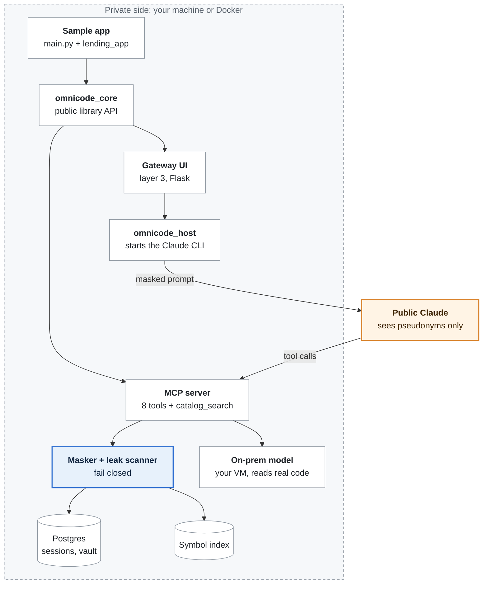
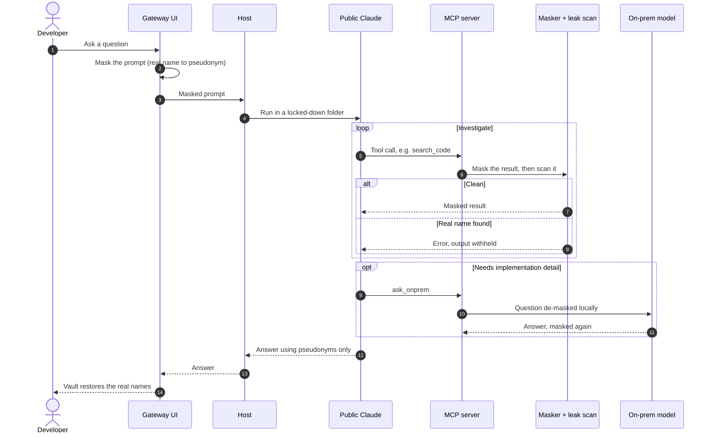

# Library Lending Sample App

> A small Java codebase that Claude can investigate **without ever seeing its real names or source code**,
> built on the private `omnicode-core` library in a handful of small Python files.

| | |
| :--- | :--- |
| **Codebase under analysis** | Java 17 library-lending system: members, loans, reservations, inventory |
| **Application code** | `main.py` and `lending_app/`: a workspace, one custom tool, two hooks |
| **Privacy model** | Claude sees pseudonyms such as `Class_A` and `Table_1`; real names are restored locally |
| **Needs** | Python 3.10+, Docker (optional), the framework folder at `../Project` |

## How it works

Everything Claude can reach passes through a masking layer and a leak scanner that fails closed.
Only the on-prem model ever reads real code.



### One question, end to end



`ask_onprem` is limited to 3 calls per session, 4,000 characters of code context in and 2,000 characters out.

## What is in this repo

| Path | Purpose |
| :--- | :--- |
| `src/main/java/...` | The codebase under analysis (models, repositories, services) |
| `sql/migrations/` | Postgres schema (`LIB_*` tables) |
| `workflows/book_checkout_flow.xml` | Checkout workflow read by the `workflow_steps` tool |
| `lending_app/config.py` | Workspace, masking rules and MCP command, defined in Python |
| `lending_app/tools.py` | Custom tool `catalog_search` |
| `lending_app/hooks.py` | Library hooks: `before_prompt`, `before_tool` |
| `lending_app/policy.py` | Card-number and destructive-SQL rules used by the hooks |
| `main.py` | Entry point: `index`, `ui`, `serve`, `diagnose` |
| `.mcp.json` | Tells Claude Code to start `python main.py serve` |
| `.claude/settings.json` | Permissions, and the OmniCode plugin from the private marketplace |

## How it uses the library

| In this app | Library call | Why |
| :--- | :--- | :--- |
| `lending_app/config.py` | `WorkspaceConfig`, `MaskingConfig`, `HostConfig`, `StorageConfig` | Describe masking terms, the `^LIB_` table pattern and how Claude starts the server |
| `lending_app/tools.py` | `@tool` | Adds `catalog_search`; its output is masked and scanned like the built-in tools |
| `lending_app/hooks.py` | `@hook`, `Allow`, `Block` | Policy: no card numbers in prompts, no `DROP` or `TRUNCATE` in tool arguments |
| `main.py ui` | `serve_ui` | Web gateway |
| `main.py serve` | `create_mcp_server` | The MCP server Claude connects to |
| `main.py diagnose` | `Agent.run` | One scripted question with the library hooks active |

## Quick start

### With Docker

```bash
cp .env.example .env            # set POSTGRES_PASSWORD, Claude auth and the on-prem model
docker compose up -d --build    # or run docker_install.bat on Windows
```

The first start builds the symbol index, then the UI is at <http://localhost:8080>.
The image contains the private framework: keep it local and never push it.

### Without Docker

```bash
python -m venv .venv && source .venv/bin/activate      # Windows: .venv\Scripts\activate
pip install -r requirements.txt                         # also installs ../Project
cp .env.example .env
python main.py index                                    # build the symbol index once
python main.py ui                                       # http://127.0.0.1:5000
python main.py diagnose "Why are on-time returns charged a fine?"
```

The leak scanner refuses to run without an index. `ui` and `diagnose` build it on first use;
run `index` yourself before `serve`, because `serve` speaks JSON-RPC on stdout and cannot print progress.

## Configuration

| Variable | Purpose |
| :--- | :--- |
| `POSTGRES_PASSWORD` | Database password (required for Docker) |
| `ANTHROPIC_API_KEY` or `CLAUDE_CODE_OAUTH_TOKEN` | How the Claude CLI authenticates; use one of them (from `claude setup-token` for the token) |
| `ONPREM_API_BASE`, `ONPREM_API_KEY`, `ONPREM_MODEL_NAME` | Your on-prem model, an OpenAI-compatible endpoint |
| `DATABASE_URL` | Set automatically in Docker; without it the app uses SQLite |

## Safety layers

| Layer | Where | What it does |
| :--- | :--- | :--- |
| Masking and leak scan | Framework | Pseudonymises every tool result and withholds anything containing a real name |
| Plugin hooks | `omnicode-sdd-plugin` from the private marketplace | Allows only `mcp__omnicode__*` tools; blocks prompts containing real symbols |
| Library hooks | `lending_app/hooks.py` | Blocks card numbers and destructive SQL in `diagnose` runs and in custom tools |

Enable the plugin by adding your marketplace to `.claude/settings.json`:

```json
{
  "extraKnownMarketplaces": {
    "omnicode-private": { "source": { "source": "git", "url": "<private-git-url>" } }
  },
  "enabledPlugins": { "omnicode-sdd-plugin@omnicode-private": true }
}
```

## Tests

```bash
pytest
```
